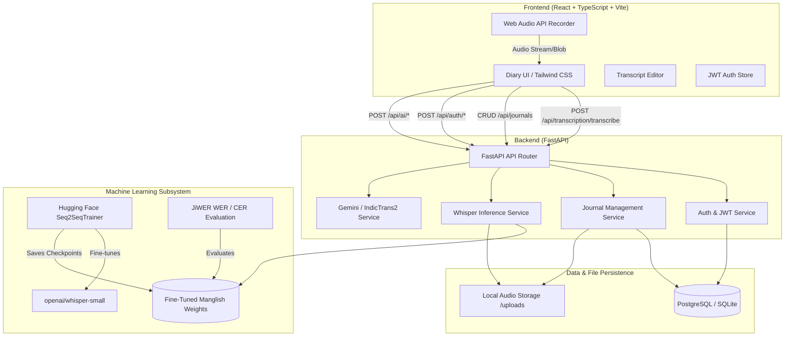

# MOZHI System Architecture

## Overview
MOZHI is an AI-powered voice journaling platform designed specifically for natural Manglish (Malayalam + English code-switched speech). The application allows users to record their voice or upload audio, transcribes it into Romanized Manglish using a fine-tuned Whisper model, and organizes journal reflections with optional AI-driven polishing, summarization, and English translation.

## Core Subsystems

### 1. Frontend Subsystem
- **Framework:** React 18 with TypeScript and Vite for near-instant HMR.
- **Styling:** Tailwind CSS with a warm, personal diary aesthetic (soft creams, muted lavenders, deep warm neutrals).
- **Audio Capture:** HTML5 `MediaRecorder` API with fallback to `AudioContext` for real-time waveform visualization, pause/resume, and duration tracking.
- **State & Communication:** Axios with interceptors for automatic JWT token injection and refresh.

### 2. Backend Subsystem
- **Framework:** FastAPI for high-throughput asynchronous execution.
- **Data Layer:** SQLAlchemy 2.0 with PostgreSQL as production DBMS and automatic SQLite fallback for rapid local development.
- **Security:** Password hashing using bcrypt / argon2 via Passlib; stateless JWT tokens with configurable expiration.
- **File Ingestion:** Uploaded audio is validated for format (WAV, MP3, M4A, WebM), hashed for idempotency, and stored in a designated, git-ignored directory (`backend/uploads/`).

### 3. Machine Learning Subsystem
- **Model Architecture:** Multilingual `openai/whisper-small` (244M parameters) consisting of an audio encoder and text decoder.
- **Audio Preprocessing:** Resampling to 16,000 Hz, mono channel, Log-Mel spectrogram feature extraction (80 bins).
- **Target Representation:** Romanized Manglish (Latin-script phonetic Malayalam code-switched with English).
- **Evaluation Metric:** JiWER-based Word Error Rate (WER) and Character Error Rate (CER), comparing fine-tuned checkpoints against base Whisper Small.
